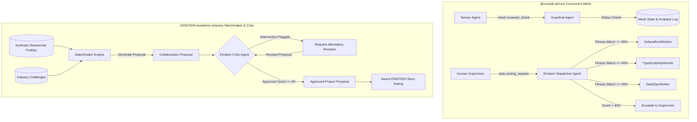

# JigJoy Concurrent Multi-Agent Mesh

[](https://github.com/sidsri14/jigjoy-concurrent-agents/actions)
[](#)
[](#)
[](https://opensource.org/licenses/MIT)

Enterprise concurrent multi-agent reactive mesh built with [Mozaik (`@mozaik-ai/core`)](https://www.npmjs.com/package/@mozaik-ai/core) for the **NTP Novi Sad / JigJoy AI Hackathon 2026** ($1,000 USD Prize Pool).

---

## 1. Architecture Overview

Rather than linear sequential agent chains (which suffer from compounding latency, context pollution, and single-point-of-failure cascades), this repository implements an asynchronous, event-driven reactive agent mesh addressing both hackathon tracks:



---

## 2. Track Deliverables

### Track 1: The Autonomous Software Factory (Guardrails & Invariants)
1. **Sensor Agent**: Ingests high-frequency telemetry events and publishes `mesh.invariant_check` events.
2. **Guardrail Agent (`SituationHandler`)**: Concurrently intercepts events via `SituationSpecification` and validates runtime constraints (`InvariantCheckProcessor`). If a safety threshold is violated (e.g. `MaxErrorRate`), it safely halts the mesh.
3. **Mock Inference Runner (`MockInferenceRunner`)**: Zero-token-cost local execution runner ensuring automated CI builds test deterministically in GitHub Actions without external API keys.

### Track 2: EINSTEIN Matchmaker (Academic-Industry Proposal Engine & Critic)
1. **Dispatcher Agent (`EinsteinDispatcherAgent`)**: Routes incoming task specifications based on domain overlap and active workload penalties (`computeMatchScore`).
2. **Adversarial Critic Agent (`EinsteinCriticAgent`)**:
   - Independently reviews proposals against 3 quantitative rubrics: **Domain Alignment (35%)**, **Budget Feasibility (35%)**, and **Methodology Rigor (30%)**.
   - Emits an **adversarial intervention** if milestones lack validation phases or if milestone budget allocations do not sum to 100%.
   - Revises and re-evaluates proposals until passing the approval threshold (Score $\ge 80$).
3. **EINSTEIN Stars Integration**: Tracks academic reputation (1.0 to 5.0 stars) weighting matchmaker pairing confidence.

---

## 3. Generated Proposals & Critic Intervention Trace (Synthetic Benchmark Dataset)

*Note: The following researcher profiles and commercial challenges are accurately labeled as a synthetic benchmark dataset.*

### Proposal 1: [APPROVED — Score 97/100]
- **Project:** Accelerated Lattice-Based Post-Quantum Cryptography Kernel for Enterprise TLS
- **Researcher:** Dr. Elena Rostova (University of Oxford, 4.8 Stars)
- **Company:** QuantSecure Systems Inc. (Cybersecurity & Defense)
- **Budget:** $175,000 USD | **Milestones:** 3 (Kernel design $\to$ OpenSSL integration $\to$ Side-channel validation)
- **Critic Verdict:** Approved on initial review.

### Proposal 2: [APPROVED AFTER INTERVENTION — Score 97/100]
- **Project:** Cryo-EM Guided Generative Chemistry for KRAS G12V Macrocycles
- **Researcher:** Prof. Marcus Vance (Stanford University, 4.9 Stars)
- **Company:** BioNova Therapeutics (Biopharmaceuticals)
- **Budget:** $340,000 USD | **Milestones:** 3
- **Critic Intervention Trace:**
  ```text
  [CRITIC INTERVENTION TRIGGERED for 'prop_kras_002']:
  - CRITIC FLAG: Milestone budget allocation sum is 110%, but must equal exactly 100%.
  - CRITIC FLAG: Insufficient granularity. At least 3 milestone phases required.
  - CRITIC FLAG: Missing dedicated verification/validation phase.
  --> Proposal revised with corrected milestone budget sum (35% + 35% + 30% = 100%) and in vitro binding assay validation.
  --> Critic Re-Evaluation Passed: Score 97/100, Status: Approved.
  ```

### Proposal 3: [APPROVED — Score 97/100]
- **Project:** Formal Verification of Solana AMM Invariants and Liquidation Bounds
- **Researcher:** Dr. Aarav Patel (Carnegie Mellon University, 4.6 Stars)
- **Company:** Solana DeFi Infrastructure Labs (Decentralized Finance)
- **Budget:** $135,000 USD | **Milestones:** 3 (Coq formal spec $\to$ Regression fuzzer $\to$ Proof artifacts)
- **Critic Verdict:** Approved on initial review.

---

## 4. Performance & Benchmarks

- **Event Throughput:** ~0.026ms per event under 100-event concurrent burst load.
- **Test Suite Execution:** **15/15 tests pass across 4 suites in ~1.5s** (`npm test`).
- **Zero Provider Cost:** 100% offline verifiable without requiring paid LLM API keys.
- **Automated CI:** Node.js 20.x & 22.x matrix passing in GitHub Actions.

---

## 5. Quickstart & Verification

```bash
# 1. Install dependencies
npm install

# 2. Run the live multi-agent simulation & EINSTEIN Critic pipeline
npm start

# 3. Run full automated test suite (15/15 passing)
npm test

# 4. Strict TypeScript typecheck
npm run typecheck

# 5. Launch interactive Web HUD visualizer
npm run serve
# Open http://localhost:3456
```

---

## Developer Information
- **Author:** Siddharth Srivastava ([@sidsri14](https://github.com/sidsri14))
- **Email:** `sidsri1502@gmail.com`
- **Payout Upwork / PayPal:** `sidsri1302@gmail.com`
- **Hackathon:** NTP Novi Sad / JigJoy AI Hackathon 2026
- **License:** MIT
